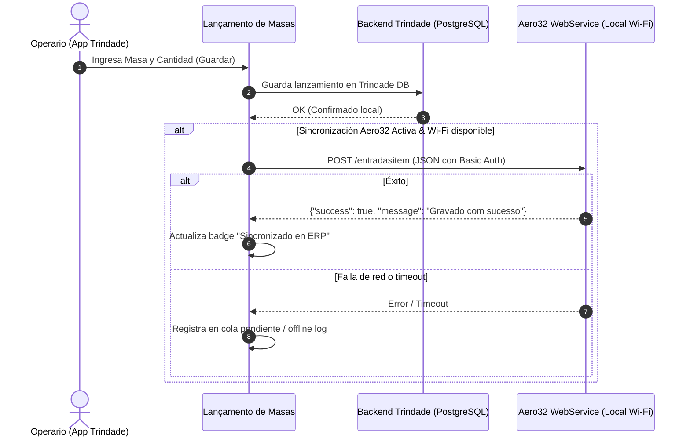

# Registro de Integración: Aero32 Mobile WebService ↔ Trindade

Documento interno de diseño técnico, contratos de API e historial de eventos/errores para la integración del módulo de **Lanzamiento de Masas** con el WebService de stock de la empresa (**Aero Estoque / Aero32**).

Este archivo es exclusivamente para uso de desarrollo y auditoría del agente; no se expone ni se gestiona a través de la interfaz web.

---

## 1. Veredicto Técnico y Hallazgos de Ingeniería Inversa

A partir del análisis binario estático de la aplicación de stock instalada en la tableta (`base.apk`, versión `br.com.aerosytem.Estoque` empaquetada con Delphi FMX y biblioteca nativa ARM64 `libso.so`):

1. **El IMEI NO se requiere ni se utiliza**:
   - El aplicativo de stock no consulta identificadores de hardware (IMEI, Serial SIM, Android ID).
   - La seguridad y sesión residen completamente en **HTTP Basic Authentication** (`Authorization: Basic base64(usuario:senha)`) contra el servidor de la empresa.
2. **Topología de Red**:
   - El WebService corre en la red local de la fábrica: `http://<IP>:<PUERTO>/api` (plantilla por defecto en código: `http://127.0.0.1:8000/api`).
   - La configuración en la tableta reside localmente en `confctrdesp.ini` (sección `[endereco]`, clave `webservice`).
3. **Restricción de Clientes (Web vs Android)**:
   - **Trindade Android (Nativa)**: El teléfono/tableta conectado a la Wi-Fi de la empresa puede realizar llamadas HTTP directas a la IP privada (`http://192.168.x.x:puerto/api`) sin restricciones de navegador. Es la vía directa recomendada.
   - **Trindade Web (Nube HTTPS)**: Los navegadores modernos bloquean peticiones desde un origen público HTTPS hacia IPs privadas HTTP locales por políticas de *Mixed Content* y *Private Network Access (PNA)*.

---

## 2. Especificación de Endpoints y Contratos JSON

Todos los endpoints esperan `Accept: application/json` y cabecera de autenticación Basic Auth.

### 2.1 Autenticación / Test de Conexión
- **Endpoint**: `POST` o `GET` a `/usuarios/`
- **Headers**:
  ```http
  Authorization: Basic base64(usuario:senha)
  Content-Type: application/json
  Accept: application/json
  ```
- **Respuesta Esperada**:
  ```json
  {
    "success": true,
    "data": {
      "CODIGO": 12,
      "SENHA": "...",
      "NOME": "OPERARIO"
    }
  }
  ```
  *Nota*: Si las credenciales fallan, retorna `success: false` o mensaje "Senha ou usuario não conferem". El campo `CODIGO` corresponde al código numérico del usuario en el ERP (`ENT_USU`).

### 2.2 Consulta de Producto
- **Endpoint**: `/produtoconsultaunico/{codigo}` o `/produtoconsulta?produto={codigo}&status=A`
- **Respuesta Esperada**:
  ```json
  {
    "success": true,
    "data": {
      "PRO_COD": "1001",
      "PRO_DES": "MASSA TRADICIONAL 500G"
    }
  }
  ```

### 2.3 Lanzamiento de Masa (Entrada de Stock)
- **Endpoint**: `POST` a `/entradasitem`
- **Payload JSON**:
  ```json
  {
    "PRO_COD": "1001",
    "PRO_DES": "MASSA TRADICIONAL 500G",
    "PRO_QTD": 50.0,
    "ENT_DTA": "2026-10-27",
    "ENT_USU": 12,
    "ENT_SER": "APL",
    "ENT_DTANOT": "2026-10-27",
    "ENT_DTMOVI": "2026-10-27",
    "ENT_OBS": "Lanzamiento desde Trindade",
    "LOTES": []
  }
  ```
- **Respuesta Esperada**:
  ```json
  {
    "success": true,
    "message": "Gravado com sucesso"
  }
  ```

### 2.4 Consulta de Movimientos del Día (Historial del Usuario)
- **Endpoint**: `POST` o `GET` a `/movimentoitem`
- **Campos devueltos por ítem**:
  - `txtLcto`: Número de lanzamiento / registro
  - `txtCodPro`: Código del producto
  - `txtDescricao`: Descripción de la masa
  - `txtQtde`: Cantidad lanzada
  - `txtData`: Fecha (`dd/mm/yyyy`)
  - `txtUsuario`: Usuario que realizó el lanzamiento
  - `txtEntSai`: Tipo de movimiento ("E" para Entrada)

---

## 3. Plan de Arquitectura en Trindade

### 3.1 Almacenamiento Local de Credenciales (Android / SharedPreferences)
- Claves:
  - `aero_ws_url`: URL del WebService (ej. `http://192.168.1.100:8000/api`)
  - `aero_ws_user`: Usuario asignado en Aero32
  - `aero_ws_pass`: Contraseña asignada en Aero32
  - `aero_ws_user_cod`: Código numérico del usuario retornado tras login (`ENT_USU`)
  - `aero_sync_enabled`: Booleano para activar el doble lanzamiento automático

### 3.2 Flujo Operativo en Lanzamiento de Masas


---

## 4. Bitácora de Pruebas Offline, Simulación y Errores

| Fecha | Entorno | Acción | Resultado / Diagnóstico | Solución / Estado |
|---|---|---|---|---|
| 2026-10-27 | Entorno local (fuera de fábrica) | Ingeniería inversa de `base.apk` / `libso.so` | Extraídos contratos de `entradasitem`, `usuarios/`, `movimentoitem` y `produtoconsulta` | Confirmado que no se requiere IMEI. Autenticación HTTP Basic estándar. |
| *Pendiente* | Fábrica (Wi-Fi) | Test de conexión con IP real | Por ejecutar al suministrar IP:PUERTO y credenciales | Requiere IP, puerto y credenciales para validar respuesta real de `/usuarios/`. |
