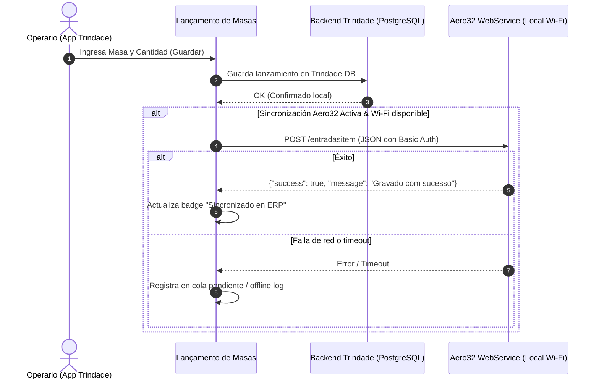

# Registro de Integración: Aero32 Mobile WebService ↔ Trindade

Documento interno de diseño técnico, contratos de API e historial de eventos/errores para la integración del módulo de **Lanzamiento de Masas** con el WebService de stock de la empresa (**Aero Estoque / Aero32**).

Este archivo es exclusivamente para uso de desarrollo y auditoría del agente; no se expone ni se gestiona a través de la interfaz web.

---

## 1. Veredicto Técnico y Hallazgos de Ingeniería Inversa

A partir del análisis binario estático de la aplicación de stock instalada en la tableta (`base.apk`, versión `br.com.aerosytem.Estoque` empaquetada con Delphi FMX y biblioteca nativa ARM64 `libso.so`):

1. **El IMEI NO se requiere ni se utiliza**:
   - El aplicativo de stock no consulta identificadores de hardware (IMEI, Serial SIM, Android ID).
   - La seguridad y sesión residen completamente en **HTTP Basic Authentication** (`Authorization: Basic base64(usuario:senha)`) contra el servidor de la empresa.
2. **Topología de Red**:
   - El WebService corre en la red local de la fábrica: `http://<IP>:<PUERTO>/api` (plantilla por defecto en código: `http://127.0.0.1:8000/api`).
   - La configuración en la tableta reside localmente en `confctrdesp.ini` (sección `[endereco]`, clave `webservice`).
3. **Restricción de Clientes (Web vs Android)**:
   - **Trindade Android (Nativa)**: El teléfono/tableta conectado a la Wi-Fi de la empresa puede realizar llamadas HTTP directas a la IP privada (`http://192.168.x.x:puerto/api`) sin restricciones de navegador. Es la vía directa recomendada.
   - **Trindade Web (Nube HTTPS)**: Los navegadores modernos bloquean peticiones desde un origen público HTTPS hacia IPs privadas HTTP locales por políticas de *Mixed Content* y *Private Network Access (PNA)*.

---

## 2. Especificación de Endpoints y Contratos JSON

Todos los endpoints esperan `Accept: application/json` y cabecera de autenticación Basic Auth.

### 2.1 Autenticación / Test de Conexión
- **Endpoint**: `POST` a `/usuarios/`. El servidor Laravel de la fábrica solo monta esa ruta como `POST`: un `GET` devuelve `405` con `The GET method is not supported for route api/usuarios. Supported methods: POST`.
- **Headers**:
  ```http
  Authorization: Basic base64(usuario:senha)
  Content-Type: application/json
  Accept: application/json
  ```
- **Respuesta Esperada**:
  ```json
  {
    "success": true,
    "data": {
      "CODIGO": 12,
      "SENHA": "...",
      "NOME": "OPERARIO"
    }
  }
  ```
  *Nota*: Si las credenciales fallan, retorna `success: false` o mensaje "Senha ou usuario não conferem". El campo `CODIGO` corresponde al código numérico del usuario en el ERP (`ENT_USU`).

### 2.2 Consulta de Producto
- **Endpoint**: `/produtoconsultaunico/{codigo}` o `/produtoconsulta?produto={codigo}&status=A`
- **Respuesta Esperada**:
  ```json
  {
    "success": true,
    "data": {
      "PRO_COD": "1001",
      "PRO_DES": "MASSA TRADICIONAL 500G"
    }
  }
  ```

### 2.3 Lanzamiento de Masa (Entrada de Stock)
- **Endpoint**: `POST` a `/entradasitem`
- **Payload JSON**:
  ```json
  {
    "PRO_COD": "001001",
    "PRO_DES": "MASSA TRADICIONAL 500G",
    "PRO_QTD": 50.0,
    "PRO_CST": "000",
    "ENT_DTA": "2026-10-27",
    "ENT_USU": 12,
    "ENT_SER": "APL",
    "ENT_DTANOT": "2026-10-27",
    "ENT_DTMOVI": "2026-10-27",
    "ENT_OBS": "Lanzamiento desde Trindade",
    "LOTES": []
  }
  ```
  *Nota*: `PRO_COD` debe enviarse rellenado a 6 dígitos con ceros a la izquierda (`000022`, `001192`), tal como lo hace el binario Delphi `base.apk` (`StringOfChar('0', 6 - Length(PRO_COD)) + PRO_COD`). Si se envía sin ceros (`22`), el trigger Firebird no localiza el registro en `PRODUTO`, no puede autocompletar la situación tributaria y aborta con `EXC_CST Favor informar a CST do Item` en `ENTRADADET_BIU_SPED_VERIFICA`. Adicionalmente, `PRO_CST` ("000" - Tributada integralmente) se incluye por compatibilidad.
- **Respuesta Esperada**:
  ```json
  {
    "success": true,
    "message": "Gravado com sucesso"
  }
  ```

### 2.4 Lanzamiento de Baja / Consumo (Salida de Stock)
- **Endpoint**: `POST` a `/saidasitem`
- **Propósito**: Dar de baja o registrar salidas de productos/insumos del stock (mismo mecanismo y protocolo que `/entradasitem`, pero decrementa stock en Firebird).
- **Origen en Binario Delphi (`base.apk` / `libso.so`)**:
  - Invocador en `0x17fb4f0`, implementación en `0x17fc2d4` / `0x17fc3c0`.
  - Construcción del payload en `0x17fb300`–`0x17fb4d0`.
- **Payload JSON**:
  ```json
  {
    "PRO_COD": "001192",
    "PRO_DES": "MASSA QUADRADA",
    "PRO_QTD": 1500,
    "PED_DTA": "2026-10-28",
    "PED_USU": "WILKIN",
    "PED_SER": "APL",
    "PED_DTANOT": "2026-10-28",
    "PED_OBS": "Saida de massas via Trindade",
    "LOTES": []
  }
  ```
- **Diferencias Críticas respecto a `/entradasitem`**:
  | Parámetro | `/entradasitem` (Entrada) | `/saidasitem` (Salida / Baja) | Regla / Justificación técnica |
  |---|---|---|---|
  | Prefijo campos de pedido | `ENT_*` (`ENT_DTA`, `ENT_USU`, etc.) | `PED_*` (`PED_DTA`, `PED_USU`, etc.) | Delphi mapea a tabla de Pedido/Salida en Firebird ERP |
  | Fecha movimiento | `ENT_DTMOVI` presente | No existe `PED_DTMOVI` | Solo se envían `PED_DTA` y `PED_DTANOT` |
  | Código de Producto (`PRO_COD`) | Relleno a 6 dígitos (`001192`) | Relleno a 6 dígitos (`001192`) | Ambos requieren 6 dígitos para triggers Firebird |
  | Cantidad (`PRO_QTD`) | Escalada × 100 (`1500` = 15 un) | Escalada × 100 (`1500` = 15 un) | Alineación estricta con enteros/decimales Firebird |
  | Usuario (`PED_USU`) | `ENT_USU` en mayúsculas | `PED_USU` en mayúsculas (`WILKIN`) | Debe ir en mayúsculas para coincidir con `NOMUSU` |
  | Serie (`PED_SER`) | `"APL"` | `"APL"` | Serie de aplicación móvil quemada en el binario |
  | Lotes (`LOTES`) | `[]` | `[]` | Array vacío por defecto si no maneja lotes |
- **Respuesta Esperada**:
  ```json
  {
    "success": true,
    "message": "Gravado com sucesso"
  }
  ```

### 2.5 Consulta de Movimientos e Historial por Usuario
- **Endpoint**: `POST` a `/movimentoitem`
- **Propósito**: Consultar los movimientos de stock registrados en el ERP (Entradas y Bajas/Salidas) filtrados por usuario logueado, producto y rango de fechas.
- **Origen en Binario Delphi (`base.apk` / `libso.so`)**:
  - Invocador en `0x17f9e64`, serialización en `0x17f9d50`–`0x17f9e40`, deserialización en `0x17fa0d8`–`0x17fa540`.
- **Request Payload JSON**:
  ```json
  {
    "CODFOR": null,
    "NOMUSU": "WILKIN",
    "CODPRO": "001192",
    "DTINI": "2026-10-28",
    "DTFIM": "2026-10-28",
    "ENTSAI": "E"
  }
  ```
  - `CODFOR`: Código de proveedor/cliente (`null` para movimientos internos de producción/stock).
  - `NOMUSU`: Nombre de usuario en mayúsculas (ej. `"WILKIN"`). Permite aislar exclusivamente lo que el operario conectado lanzó o dio de baja.
  - `CODPRO`: Código de producto a 6 dígitos (ej. `"001192"`) o `null` para consultar todos los productos.
  - `DTINI` / `DTFIM`: Rango de fechas en formato ISO `YYYY-MM-DD`.
  - `ENTSAI`: Filtro de dirección de stock:
    - `"E"`: Solo Entradas / Lanzamientos de producción.
    - `"S"`: Solo Salidas / Bajas de inventario.
    - `null` / vacío: Todos los movimientos.
- **Response Schema JSON**:
  ```json
  {
    "success": true,
    "data": [
      {
        "ENT_LAN": 10542,
        "PRO_COD": "001192",
        "PRO_DES": "MASSA TRADICIONAL 500G",
        "PRO_QTD": 90.0,
        "ENT_DTA": "2026-10-28",
        "ENT_USU": "WILKIN",
        "ENTSAI": "E"
      }
    ]
  }
  ```
- **Mapeo de Controles UI Delphi (`base.apk`) a Campos de Respuesta**:
  | Campo JSON ERP | Control UI Delphi | Significado | Formato / Máscara |
  |---|---|---|---|
  | `ENT_LAN` | `txtLcto` | Número de lanzamiento / asiento ERP | Numérico entero |
  | `PRO_COD` | `txtCodPro` | Código del producto ERP | 6 dígitos con ceros |
  | `PRO_DES` | `txtDescricao` | Nombre / descripción de la masa | Texto descriptivo |
  | `PRO_QTD` | `txtQtde` | Cantidad registrada | Máscara `##0.00` |
  | `ENT_DTA` | `txtData` | Fecha de registro | Formato `dd/mm/yyyy` |
  | `ENT_USU` | `txtUsuario` | Operario responsable | Mayúsculas (`NOMUSU`) |
  | `ENTSAI` | `txtEntSai` | Tipo de movimiento | `"E"` (Entrada) / `"S"` (Salida) |

### 2.6 Consulta de Catálogo de Productos
- **Endpoint Único**: `GET` a `/produtoconsultaunico/{codigo}`
- **Endpoint Lista/Búsqueda**: `GET` a `/produtoconsulta?produto={codigo}&status=A`
- **Respuesta Esperada**:
  ```json
  {
    "success": true,
    "data": {
      "PRO_COD": "001192",
      "PRO_DES": "MASSA TRADICIONAL 500G"
    }
  }
  ```

---

## 3. Plan de Arquitectura en Trindade

### 3.1 Almacenamiento Local de Credenciales (Android / SharedPreferences)
- Claves:
  - `aero_ws_url`: URL del WebService (ej. `http://192.168.1.100:8000/api`)
  - `aero_ws_user`: Usuario asignado en Aero32
  - `aero_ws_pass`: Contraseña asignada en Aero32
  - `aero_ws_user_cod`: Código numérico del usuario retornado tras login (`ENT_USU`)
  - `aero_sync_enabled`: Booleano para activar el doble lanzamiento automático

### 3.2 Flujo Operativo en Lanzamiento de Masas


---

## 4. Bitácora de Pruebas Offline, Simulación y Errores

| Fecha | Entorno | Acción | Resultado / Diagnóstico | Solución / Estado |
|---|---|---|---|---|
| 2026-10-27 | Entorno local (fuera de fábrica) | Ingeniería inversa de `base.apk` / `libso.so` | Extraídos contratos de `entradasitem`, `usuarios/`, `movimentoitem` y `produtoconsulta` | Confirmado que no se requiere IMEI. Autenticación HTTP Basic estándar. |
| 2026-10-28 | Fábrica (red real) | Prueba del panel desde el iPhone | `405` en `/usuarios/`: la ruta solo acepta `POST` | Probe del cliente cambiado a `POST` (`aero-connection.ts`) |
| 2026-10-28 | Producción (HTTPS) | Test de conexión delegado al atajo | Safari bloquea el `POST` HTTP desde la página HTTPS: el botón no podía probar lo que el lanzamiento sí hace | Segundo atajo `Aero32 Prueba` de 3 acciones; la página lee `aero_test` y escribe `requested` + `result` en la bitácora |
| 2026-10-28 | Fábrica (red real) | Lanzamiento con atajo definitivo | Envío de JSON exitoso con acción 'Definir nome: payload.json'. Laravel deserializó todos los campos. Trigger Firebird `ENTRADADET_BIU_SPED_VERIFICA` requirió CST del ítem | Payload incluye `PRO_CST: '000'` estándar de fabricación propia. `formatAeroProductCode` a 6 dígitos con ceros a la izquierda y `ENT_USU` en mayúsculas (`.toUpperCase()`) garantizados. |
| 2026-10-28 | Entorno local | Desensamblado profundo ARM64 (`libso.so`) para salidas e historial | Identificados endpoints `/saidasitem` (campos `PED_*`, escalado x100) y `/movimentoitem` (filtros `NOMUSU`, `ENTSAI`, campos `ENT_LAN`) | Documentados contratos JSON para bajas de stock y consulta de movimientos por usuario. |
| 2026-10-28 | Entorno local | Atajo único «Aero32 Bridge» (8 acciones) en lugar de dos atajos | El diseño partido obligaba a editar el iPhone cada vez que cambiaban la IP o la contraseña, y el `body` como diccionario se convertía en plist en el cuerpo del `POST` | El sobre `{ url, auth, body, callback }` viaja en la entrada; `body` se serializa con `JSON.stringify` y la credencial se arma en el momento. Un solo atajo cubre `entradasitem`, `saidasitem`, `movimentoitem` y `usuarios/` |
| 2026-10-28 | Entorno local | Campo «Código do Usuário no ERP» eliminado del panel | `libso.so` confirma que `ENT_USU` recibe el nombre en mayúsculas; el `CODIGO` del probe es informativo y el campo confundía al operario | El panel pide tres datos (URL, usuario, contraseña). Un teléfono con el valor viejo lo descarta al leer los ajustes |
| *Pendiente* | Fábrica (Wi-Fi) | Lanzamiento de 1 caja para verificar confirmación ERP | Validar inserción en base Firebird con `{"success":true,"message":"Gravado com sucesso"}` | Pendiente de prueba por Wilkin en iPhone |
