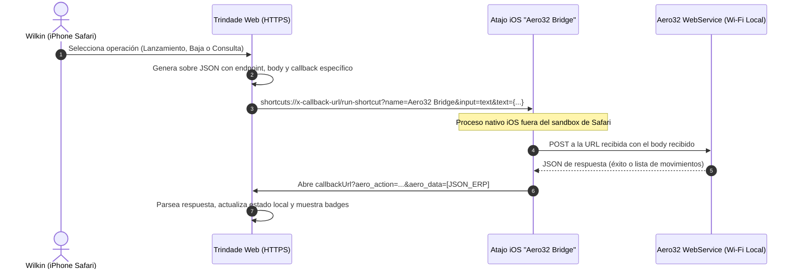
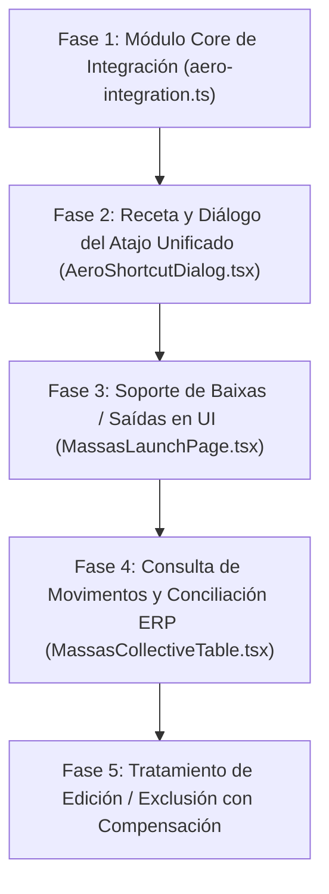

# Reporte de Arquitectura: Integración Aero32 Completa y Atajo Unificado

Documento de diseño arquitectónico para soportar el ciclo completo de inventario de **Aero32 WebService** en la aplicación web **Trindade**:
1. **Lanzamiento de Masas / Producción (Entradas)**: `POST /api/entradasitem` (actualmente activo).
2. **Baja de Stock / Desecho / Consumo (Salidas)**: `POST /api/saidasitem` (nuevo).
3. **Consulta de Movimientos del Usuario (Historial ERP)**: `POST /api/movimentoitem` (nuevo).

---

## 1. El Dilema del Atajo de iOS: ¿Atajos Separados o Atajo Unificado?

### 1.1 El problema de la proliferación de atajos
En el diseño original, cada atajo tenía la URL de destino y la cabecera quemadas adentro:
- `Aero32 Estoque` → quemado a `/entradasitem`
- `Aero32 Prueba` → quemado a `/usuarios/`

Si continuáramos con ese patrón para cubrir las 3 operaciones nuevas, tendrías que crear y mantener **4 atajos distintos** en tu iPhone:
1. `Aero32 Estoque` (Entradas)
2. `Aero32 Saida` (Salidas)
3. `Aero32 Movimentos` (Consulta)
4. `Aero32 Prueba` (Test de login)

> [!WARNING]
> En un entorno de planta de fábrica, tener 4 atajos manuales es una carga operativa frágil: ante cualquier cambio de IP, puerto o credencial en el servidor, tendrías que editar 4 recetas a mano en la app Atajos de iOS.

---

### 1.2 La Solución Recomendada: «Aero32 Bridge» (Atajo Unificado de 8 Acciones)

En lugar de que el atajo conozca el negocio, el atajo debe actuar como un **puente de red ciego (HTTP Proxy)**. Toda la inteligencia reside en la aplicación web Trindade, y el atajo solo recibe un sobre JSON genérico:

```json
{
  "url": "http://192.168.1.50:8000/api/saidasitem",
  "method": "POST",
  "headers": {
    "Authorization": "Basic d2lsa2luOnNlbmhh",
    "Content-Type": "application/json",
    "Accept": "application/json"
  },
  "body": "{\"PRO_COD\":\"001192\",\"PRO_DES\":\"MASSA QUADRADA\",\"PRO_QTD\":1500,...}",
  "callback": "https://trindademasas.duckdns.org/massas-launch?aero_action=saida&aero_data="
}
```

> **El `body` viaja serializado como string JSON.** Si se inserta un *diccionario* en «Cuerpo de la
> petición: Texto», iOS lo renderiza como lista de propiedades y el ERP rechaza el pedido aunque el
> encabezado siga diciendo `application/json`. La web serializa antes de que el teléfono lo vea.
>
> **La credencial viaja en el sobre (opción B).** Cuesta dos lecturas de diccionario más en el teléfono y
> compra lo que Wilkin pidió: rotar la contraseña en la web no obliga a editar el atajo nunca más.

#### Receta del Atajo Unificado (`Aero32 Bridge`) — 8 acciones en iOS:

Las cuatro «acciones» de la versión original de este documento eran pasos, no acciones: cada clave del
diccionario necesita su propia acción de «Obtener valor del diccionario». Con el sobre de la opción B el
conteo real es ocho, y así lo muestra el diálogo de la aplicación.

1. **Acción 1**: «Obtener diccionario de la entrada» (`Entrada del atajo`).
2. **Acción 2**: «Obtener valor del diccionario», clave `url`.
3. **Acción 3**: «Obtener valor del diccionario», clave `auth`.
4. **Acción 4**: «Obtener valor del diccionario», clave `body`.
5. **Acción 5**: «Obtener valor del diccionario», clave `callback`.
6. **Acción 6**: «Obtener contenido de URL»:
   - **URL**: variable `url`.
   - **Método**: `POST`.
   - **Encabezados**: `Authorization` = variable `auth`, `Content-Type: application/json`,
     `Accept: application/json`.
   - **Cuerpo de la petición**: `Texto` → variable `body`.
7. **Acción 7**: «Codificar URL» sobre el `Contenido de URL`.
8. **Acción 8**: «Abrir URLs»: variable `callback` + resultado de la acción 7.



### 1.3 Tabla Comparativa

| Criterio | Opción A: Atajos Específicos | Opción B: Atajo Unificado «Aero32 Bridge» (Recomendada) |
|---|---|---|
| **Cantidad de Atajos en iPhone** | 4 atajos diferentes | **1 solo atajo para siempre** |
| **Complejidad de la Receta** | 2 acciones por atajo | 4 acciones directas |
| **Mantenimiento ante cambios** | Modificar 4 atajos si cambia la IP | Se actualiza en la Web; el atajo no cambia |
| **Flexibilidad** | Limitado a lo preconfigurado | Soporta cualquier endpoint futuro automáticamente |

---

## 2. Contratos de las 3 Operaciones en el Atajo Unificado

### Operación 1: Lanzamiento de Producción (`POST /api/entradasitem`)
- **Propósito**: Incrementar stock de masas producidas en Firebird.
- **Payload (`body`)**:
  ```json
  {
    "PRO_COD": "001192",
    "PRO_DES": "MASSA QUADRADA",
    "PRO_QTD": 1500,
    "PRO_CST": "000",
    "ENT_DTA": "2026-10-28",
    "ENT_USU": "WILKIN",
    "ENT_SER": "APL",
    "ENT_DTANOT": "2026-10-28",
    "ENT_DTMOVI": "2026-10-28",
    "ENT_OBS": "Lancamento de massas via Trindade",
    "LOTES": []
  }
  ```
- **Callback al retornar a Safari**:
  `https://trindademasas.duckdns.org/massas-launch?aero_action=entrada&aero_data={"success":true,"message":"Gravado com sucesso"}`

---

### Operación 2: Baja / Salida de Stock (`POST /api/saidasitem`)
- **Propósito**: Decrementar stock de insumos o masas por mermas, desecho, rotura o consumo interno.
- **Payload (`body`)**:
  ```json
  {
    "PRO_COD": "001192",
    "PRO_DES": "MASSA QUADRADA",
    "PRO_QTD": 1500,
    "PED_DTA": "2026-10-28",
    "PED_USU": "WILKIN",
    "PED_SER": "APL",
    "PED_DTANOT": "2026-10-28",
    "PED_OBS": "Saida de massas via Trindade",
    "LOTES": []
  }
  ```
- **Diferencia técnica**: Utiliza campos prefijados con `PED_*` en vez de `ENT_*` y omite `PED_DTMOVI`.
- **Callback al retornar a Safari**:
  `https://trindademasas.duckdns.org/massas-launch?aero_action=saida&aero_data={"success":true,"message":"Gravado com sucesso"}`

---

### Operación 3: Consulta de Movimientos por Usuario (`POST /api/movimentoitem`)
- **Propósito**: Obtener los asientos registrados en Firebird por el usuario logueado en la fecha indicada.
- **Payload (`body`)**:
  ```json
  {
    "CODFOR": null,
    "NOMUSU": "WILKIN",
    "CODPRO": null,
    "DTINI": "2026-10-28",
    "DTFIM": "2026-10-28",
    "ENTSAI": null
  }
  ```
- **Respuesta que el atajo trae de vuelta en la URL**:
  ```json
  {
    "success": true,
    "data": [
      {
        "ENT_LAN": 10542,
        "PRO_COD": "001192",
        "PRO_DES": "MASSA QUADRADA",
        "PRO_QTD": 15.0,
        "ENT_DTA": "2026-10-28",
        "ENT_USU": "WILKIN",
        "ENTSAI": "E"
      }
    ]
  }
  ```
- **Callback al retornar a Safari**:
  `https://trindademasas.duckdns.org/massas-launch?aero_action=movimentos&aero_data=[JSON_ARRAY_ESCAPED]`
- **Ojo con la cantidad**: el pedido va escalado ×100 (`1500` = 15 unidades) pero la **respuesta vuelve en
  unidades humanas** (`15.0`, máscara `##0.00` en `libso.so`). La conciliación de la fase 4 compara contra
  `PRO_QTD` tal como llega, nunca contra el entero escalado que se envió.

---

## 3. Integración en la Interfaz de Usuario de Trindade

### 3.1 Grilla de Lanzamiento (`MassasLaunchPage.tsx`)
1. **Selector de Movimiento (Tabs / Segmented Control)**:
   - Arriba de la grilla de productos:
     `[ 📦 Entrada (Produção) ]`  |  `[ 🔻 Baixa / Saída (Perda / Consumo) ]`
   - El modo `Entrada` mantiene el comportamiento actual.
   - El modo `Baixa / Saída` tiñe los bordes en tono rojizo/ámbar oscuro, solicita confirmación con motivo de baja ("Desecho", "Merma", "Consumo interno") y dispara el payload hacia `/saidasitem`.

2. **Botón de Conciliación con ERP (`AeroSyncHistoryButton`)**:
   - Junto al botón de WhatsApp y la selección de fecha:
     `[ 🔄 Sincronizar com ERP ]`
   - Al tocarlo, invoca a `Aero32 Bridge` con `/movimentoitem`.
   - Al regresar a Safari, Trindade cruza en memoria los asientos devueltos por Firebird con la tabla local.

### 3.2 Tabla Colectiva de Lanzamientos (`MassasCollectiveTable.tsx`)
1. **Badges de Estado ERP por Fila**:
   - Cada fila de lanzamiento de un operario mostrará un indicador visual:
     - 🟢 **Sincronizado no ERP (Assento #10542)**: si coincide en fecha, producto y cantidad con un registro de `/movimentoitem`.
     - 🟡 **Pendente de sincronização**: si existe en Trindade pero aún no en Firebird.
     - 🔵 **Lançamento externo (Tablete)**: si vino del ERP pero no se cargó originalmente en Trindade.

### 3.3 Reglas de Negocio para Edición y Eliminación
> [!IMPORTANT]
> El ERP Firebird no expone endpoints REST para `DELETE` o `UPDATE` de asientos ya confirmados (`ENT_LAN`). En el binario Delphi `base.apk`, los registros grabados son inmutables desde el cliente móvil.

Por lo tanto, la interacción al editar o eliminar en Trindade debe ser:
1. **Si el lanzamiento NO fue sincronizado aún con el ERP**:
   - Se puede editar o borrar libremente en Trindade sin afectar al ERP.
2. **Si el lanzamiento YA fue sincronizado con el ERP (`ENT_LAN` presente)**:
   - Trindade advertirá al Administrador:
     > *"Este lançamento já foi registrado no ERP da empresa com o Assento #10542. A exclusão local não cancela o assento contábil no Firebird. Deseja registrar uma Baixa de compensação de X unidades no ERP?"*
   - Si el usuario acepta, el sistema puede disparar automáticamente una Salida (`/saidasitem`) por la diferencia para anular o ajustar el stock en Firebird.

---

## 4. Plan de Implementación por Fases



1. **Fase 1 — Core (`packages/frontend/src/lib/aero-integration.ts`)**:
   - Implementar `buildSaidaItemPayload` (con prefijos `PED_*`).
   - Implementar `buildMovimentoItemPayload` (filtros `NOMUSU`, `DTINI`, `DTFIM`, `ENTSAI`).
   - Crear `buildAeroBridgeEnvelope` para el atajo unificado.
   - Extender `parseAeroCallback` para deserializar las 3 acciones (`entrada`, `saida`, `movimentos`).

2. **Fase 2 — Diálogo y Receta (`AeroShortcutDialog.tsx`)**:
   - Reemplazar la receta dual por la receta del atajo único `Aero32 Bridge` (4 acciones).
   - Botón de test integrado que usa el mismo atajo apuntando a `/usuarios/`.

3. **Fase 3 — UI de Saídas / Baixas (`MassasLaunchPage.tsx`)**:
   - Incorporar switch o pestañas Entrada / Saída.
   - Conectar la cola de envíos para soportar envíos de salida en lote.

4. **Fase 4 — Consulta y Conciliación ERP (`MassasCollectiveTable.tsx`)**:
   - Añadir botón de sincronización de movimientos.
   - Renderizar badges de confirmación de asiento contable (`ENT_LAN`).

5. **Fase 5 — Edición y Eliminación Segura**:
   - Modal de advertencia y opción de compensación contable en caso de modificar ítems ya sincronizados.
